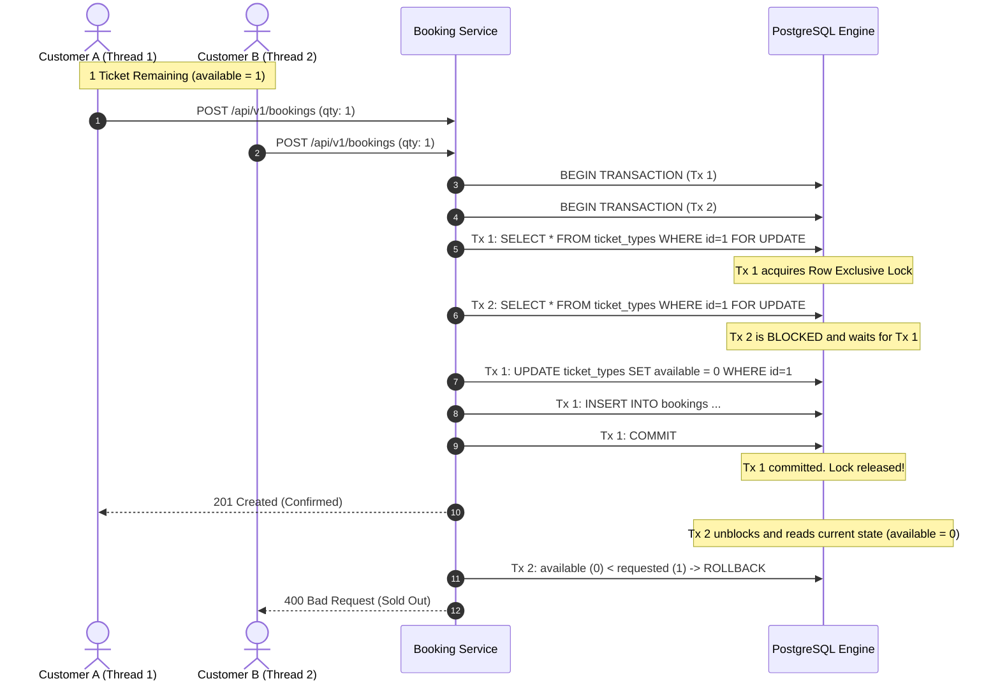

# EventFlow — High-Concurrency Event Reservation Platform

<p align="center">
  <strong>Production-Grade Full-Stack Event Booking System with PostgreSQL Row-Level Concurrency Control & Cloud-Native DevOps Automation</strong>
</p>

<p align="center">
  
  
  
  
  
  
  
  
  
</p>

---

## 1. Overview & Concurrency Guarantee

**EventFlow** is an enterprise event ticketing platform engineered to eliminate overselling during high-demand flash sales.

### The Engineering Challenge
In traditional booking applications using non-transactional or optimistic read-then-write updates:
1. Two simultaneous requests check availability (`available = 1`).
2. Both evaluate `1 >= 1` as valid.
3. Both execute `UPDATE ticket_types SET available = available - 1`.
4. **Failure**: Inventory drops to `-1`, resulting in duplicate seat allocations and financial reconciliation issues.

### The EventFlow Solution
EventFlow implements **Pessimistic Row-Level Locking** powered by PostgreSQL's `SELECT ... FOR UPDATE` inside an atomic database transaction:
- Exclusively locks the specific `TicketType` row at the database engine level.
- Queues competing transactions deterministically.
- Validates quota, decrements inventory, freezes prices, records booking items, and commits atomically.
- **Guarantee**: Mathematical zero overbooking, verified by multi-threaded stress tests and k6 flash-sale simulations.



---

## 2. Quick Start (Local Development)

### Prerequisites
- Python 3.11+
- Node.js 20+
- PowerShell (Windows) or GNU Make (Linux/macOS)

### Start Servers

#### Terminal 1: Backend API (Flask on Port 5000)
```powershell
# Windows PowerShell
.\scripts\dev.ps1 run-backend

# Linux / macOS
make run-backend
```
- **API Root**: `http://localhost:5000/api/v1`
- **Health Probe**: `http://localhost:5000/health`
- **Prometheus Metrics**: `http://localhost:5000/metrics`

#### Terminal 2: Frontend SPA (React + Vite on Port 3000)
```powershell
# Windows PowerShell
.\scripts\dev.ps1 run-frontend

# Linux / macOS
make run-frontend
```
- **App URL**: `http://localhost:3000`
- API calls to `/api/*` are automatically proxied to port 5000.

### Pre-Seeded Admin Credentials
| Field | Value | Role |
|---|---|---|
| **URL** | `http://localhost:3000/login` | Login page |
| **Email** | `admin@eventflow.dev` | Administrator |
| **Password** | `Admin1234!` | Access to Admin Hub, Event Creation, User Directory, Analytics |

---

## 3. Public Concurrent Testing (Cloudflare Tunnel)

To allow external users or teammates to access the live app and test concurrent ticket booking simultaneously:

```powershell
cloudflared tunnel --url http://localhost:3000
```
- Generates an instant public HTTPS URL (`https://<random-name>.trycloudflare.com`).
- Vite is pre-configured with `server.allowedHosts: true` to accept tunnel hostnames.
- Multiple users can sign in and book tickets at the exact same millisecond to test row-level locking.

---

## 4. Production Containerization & Kubernetes

### Docker Compose
Run the full stack with PostgreSQL, Flask, React/Nginx, Prometheus, and Grafana:
```powershell
.\scripts\dev.ps1 docker-up       # Start all containers in background
.\scripts\dev.ps1 docker-status   # Inspect container health
.\scripts\dev.ps1 docker-logs     # Stream real-time logs
.\scripts\dev.ps1 docker-down     # Stop stack cleanly
```

### Kubernetes (Kustomize Declarative Manifests)
Deploy to any local or cloud Kubernetes cluster (Minikube, Kind, GKE, EKS, DOKS):
```powershell
.\scripts\dev.ps1 k8s-apply      # Apply namespace, secrets, DB, backend, frontend
.\scripts\dev.ps1 k8s-status     # Inspect running pods and services
.\scripts\dev.ps1 hpa-status     # Monitor Horizontal Pod Autoscaler (2-8 replicas at 60% CPU)
.\scripts\dev.ps1 k8s-delete     # Clean teardown
```

---

## 5. Observability & Telemetry

EventFlow provides full platform telemetry out of the box:

```powershell
.\scripts\dev.ps1 obs-up         # Starts Prometheus (port 9090) and Grafana (port 3001)
```

- **Prometheus Endpoint**: `http://localhost:5000/metrics`
  - `http_requests_total`: Throughput by status code and route
  - `http_request_duration_seconds`: P50, P95, and P99 latency percentiles
  - `bookings_total`: Atomic business reservations (`confirmed` vs `cancelled`)
- **Grafana Dashboard**: `http://localhost:3001` (Credentials: `admin` / `admin123`)
  - Auto-refreshing dashboard tracking throughput, latency curves, conversion rate, and process memory/CPU.

---

## 6. Testing & Quality Verification

```powershell
.\scripts\dev.ps1 test               # Run all 55 Pytest test cases
.\scripts\dev.ps1 test-unit          # Fast unit tests (auth, schemas)
.\scripts\dev.ps1 test-concurrency   # 20-thread concurrency stress test (PostgreSQL required)
.\scripts\dev.ps1 lint               # Strict Ruff syntax and format check
.\scripts\dev.ps1 load-test          # Run k6 flash-sale load simulation
```

- **CI Pipeline**: Automated via `.github/workflows/ci.yml` running linting, live Postgres integration tests, frontend compilation, and Docker validations.
- **Image Publisher**: Automated via `.github/workflows/publish.yml` publishing to GitHub Container Registry (`ghcr.io`).

---

## 7. Database Operations & Quick Management

For inspecting, modifying, or cleaning testing data:

```powershell
.\scripts\dev.ps1 list-users        # View all registered users and roles
.\scripts\dev.ps1 list-bookings     # View all orders and totals in ₹ Rupees
```

> [!TIP]
> For targeted deletions (deleting specific users, bookings, or clearing all test orders), refer to the **[Database Operations & Quick Deletion Guide](file:///d:/BookingLite/DATABASE_OPERATIONS.md)**.

---

## 8. API Summary

All endpoints return JSON and use standard HTTP status codes.

| Method | Endpoint | Access | Description |
|---|---|---|---|
| `POST` | `/api/v1/auth/register` | Public | Register new customer account |
| `POST` | `/api/v1/auth/login` | Public | Authenticate user & return JWT token |
| `GET` | `/api/v1/auth/me` | Authenticated | Retrieve current user profile |
| `GET` | `/api/v1/events` | Public | List published events with search & pagination |
| `GET` | `/api/v1/events/:id` | Public | Event details and available ticket tiers |
| `POST` | `/api/v1/events` | Admin | Create new event (`draft` or `published`) |
| `PATCH`| `/api/v1/events/:id` | Admin | Update event details or status |
| `POST` | `/api/v1/events/:id/cancel` | Admin | Cancel event and take off market |
| `POST` | `/api/v1/events/:id/ticket-types` | Admin | Add ticket tier with capacity and price |
| `POST` | `/api/v1/bookings` | Authenticated | **Atomic reservation** with pessimistic row lock |
| `GET` | `/api/v1/bookings` | Authenticated | List bookings (Customer: own; Admin: all) |
| `GET` | `/api/v1/bookings/:id` | Authenticated | Booking voucher details & items |
| `POST` | `/api/v1/bookings/:id/cancel` | Authenticated | Cancel booking & atomically restore stock |
| `GET` | `/api/v1/admin/dashboard` | Admin | Live KPI analytics (revenue, tickets, inventory) |
| `GET` | `/api/v1/admin/users` | Admin | Directory of all registered accounts |
| `GET` | `/health` | Public | Application & database health probe |
| `GET` | `/metrics` | Public | Prometheus telemetry scrapable endpoint |

---

## 9. Repository Structure

```text
├── backend/
│   ├── app/
│   │   ├── api/             # REST blueprints (auth, events, bookings, admin)
│   │   ├── auth/            # JWT validation & RBAC decorators
│   │   ├── models/          # SQLAlchemy models (User, Event, TicketType, Booking)
│   │   ├── schemas/         # Marshmallow request validation schemas
│   │   ├── services/        # Concurrency engine (booking_service.py)
│   │   ├── config.py        # Environment-aware application settings
│   │   ├── health.py        # Liveness & readiness probes
│   │   └── metrics.py       # Prometheus latency & counter metrics
│   ├── tests/               # 55 automated tests (unit, integration, concurrency)
│   └── Dockerfile           # Multi-stage hardened Python container
│
├── frontend/
│   ├── src/
│   │   ├── pages/           # Customer portal, Booking stubs, Admin Hub, Users
│   │   ├── components/      # Glassmorphic UI components, TicketSelector, Modals
│   │   ├── context/         # AuthContext and session management
│   │   ├── services/        # Axios API clients
│   │   └── index.css        # Premium glassmorphic design system
│   └── Dockerfile           # Multi-stage Vite build + Nginx Alpine runtime
│
├── k8s/                     # Production Kubernetes declarative manifests
│   ├── backend/             # Deployments & ClusterIP services
│   ├── frontend/            # Deployments & NodePort services
│   ├── postgres/            # StatefulSet with PersistentVolumeClaim
│   ├── jobs/                # Database pre-flight schema migration Job
│   ├── observability/       # Prometheus scraper & Grafana dashboard manifests
│   ├── hpa.yaml             # Horizontal Pod Autoscaler (2-8 pods at 60% CPU)
│   └── kustomization.yaml   # Kustomize root manifest
│
├── scripts/
│   ├── dev.ps1              # PowerShell CLI runner for Windows developers
│   └── k6-load-test.js      # Flash-sale concurrency load test script
│
├── docker-compose.yml       # Multi-container orchestration with health checks
├── DATABASE_OPERATIONS.md   # Copy-paste database management & deletion cheat sheet
└── pyproject.toml           # Unified Python tooling configuration (Ruff, Pytest)
```

---

## 10. License

EventFlow is licensed under the **MIT License**.
