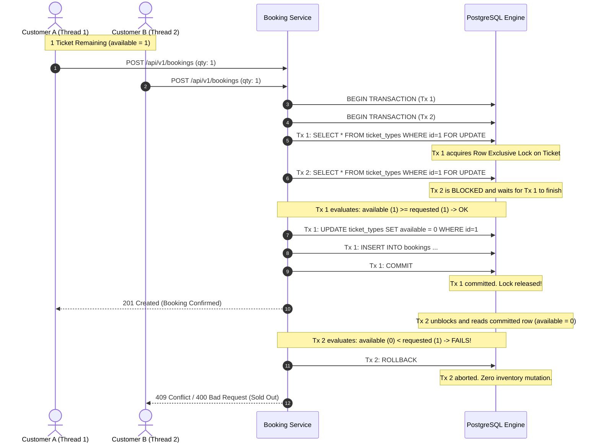
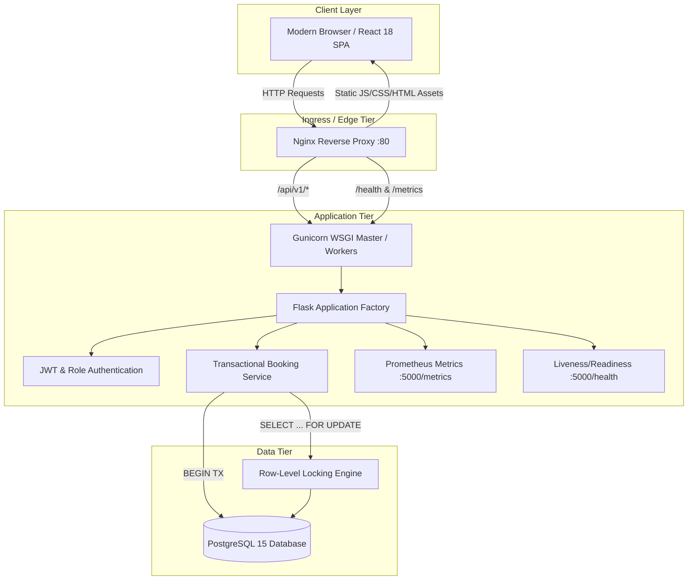
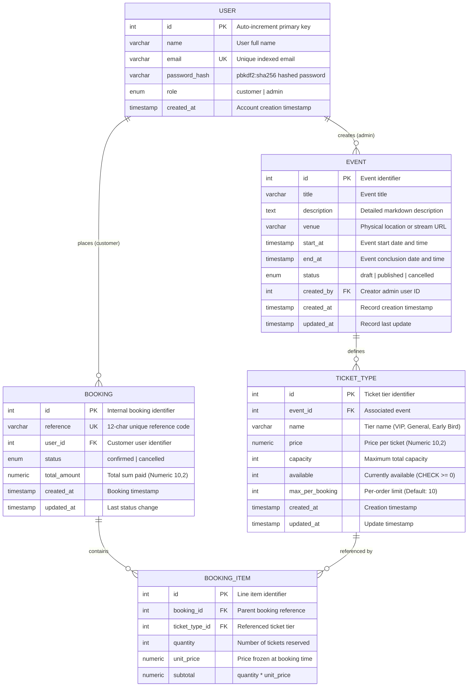

# EventFlow - High-Concurrency Event Reservation Platform

<p align="center">
  <strong>Production-Grade Full-Stack Event Booking System with PostgreSQL Row-Level Concurrency Control & End-to-End DevOps Automation</strong>
</p>

<p align="center">
  
  
  
  
  
  
  
  
  
  
</p>

> [!NOTE]
> **DevOps Course Project Context**: This project was developed as a comprehensive **DevOps Course-Based Project** (B.Tech Computer Science and Engineering - Cloud-Native DevOps curriculum). It demonstrates the complete, end-to-end software delivery lifecycle (SDLC) - including domain-driven backend architecture, transactional row-level concurrency locking, a cinematic React SPA, containerization, automated testing quality gates, Kubernetes manifests, autoscaling with HPA, and real-time Prometheus observability.

---

## Table of Contents
1. [Project Overview & Engineering Highlights](#1-project-overview--engineering-highlights)
2. [Quick Start: How to Open the UI and Server](#2-quick-start-how-to-open-the-ui-and-server)
3. [Master Project Roadmap: Plan vs. Current Progress](#3-master-project-roadmap-plan-vs-current-progress)
4. [Deep Dive: Concurrency Control & Inventory Safety](#4-deep-dive-concurrency-control--inventory-safety)
5. [System Architecture & Data Flows](#5-system-architecture--data-flows)
6. [Database Entity-Relationship Model](#6-database-entity-relationship-model)
7. [Complete Repository Structure](#7-complete-repository-structure)
8. [API Specification & Example Payloads](#8-api-specification--example-payloads)
9. [Frontend Architecture, Design System & UI Testing Guide](#9-frontend-architecture--design-system)
10. [Security, Hardening & Role-Based Access Control](#10-security-hardening--role-based-access-control)
11. [Local Development Guide (PowerShell & Make)](#11-local-development-guide-powershell--make)
12. [Automated Testing & Concurrency Verification](#12-automated-testing--concurrency-verification)
13. [Troubleshooting & Frequently Asked Questions](#13-troubleshooting--frequently-asked-questions)
14. [Upcoming DevOps Phases Roadmap](#14-upcoming-devops-phases-roadmap)

---

## 1. Project Overview & Engineering Highlights

**EventFlow** is an enterprise-grade, distributed event ticket booking and reservation platform. It was engineered to showcase the complete modern software delivery lifecycle: from clean backend domain architecture and strict transactional concurrency, to a responsive frontend SPA, containerization, automated testing, and cloud-native observability.

### The Real-World Engineering Problem
In modern high-demand ticketing platforms (concert tours, developer conferences, sporting events), thousands of users attempt to purchase remaining tickets within milliseconds of a flash sale launching. 

Standard web applications that implement non-transactional or optimistic read-then-write updates fail dramatically under this load:
1. Two concurrent requests check availability (`available = 1`).
2. Both evaluate `1 >= 1` as valid.
3. Both execute `UPDATE ticket_types SET available = available - 1`.
4. Result: **Oversold inventory** (`available = -1`), duplicate seat allocations, broken customer trust, and financial reconciliation nightmares.

### How EventFlow Solves This
EventFlow implements **Pessimistic Row-Level Locking** powered by PostgreSQL's `SELECT ... FOR UPDATE` within an atomic database transaction:
- When a user initiates a booking, EventFlow locks the specific `TicketType` row exclusively.
- All other concurrent transactions targeting the same ticket tier queue deterministically at the database engine level.
- The transaction checks stock, decrements inventory, creates the booking record, and commits - releasing the lock atomically.
- **Result: Mathematical zero overbooking**, verified by high-concurrency stress tests.

---

## 2. Quick Start: How to Open the UI and Server

To run the complete full-stack application locally, you open two terminal windows (one for the backend API server, and one for the frontend UI):

### Terminal 1: Start the Backend Server (Flask REST API)
From the project root directory (`d:\BookingLite`):

- **On Windows (PowerShell)**:
  ```powershell
  # 1. Install backend dependencies (first time only)
  pip install -r backend/requirements.txt

  # 2. Start the Flask API server
  .\scripts\dev.ps1 run-backend
  ```
- **On Linux / macOS**:
  ```bash
  make run-backend
  ```
- **Direct command alternative**:
  ```bash
  flask --app backend/wsgi.py run --host=0.0.0.0 --port=5000
  ```

#### Backend Access Endpoints:
- **API Root**: [http://localhost:5000/api/v1](http://localhost:5000/api/v1)
- **Health Check Probe**: [http://localhost:5000/health](http://localhost:5000/health) *(returns `{"status": "ok", "db": "healthy"}`)*
- **Prometheus Metrics Target**: [http://localhost:5000/metrics](http://localhost:5000/metrics)

---

### Terminal 2: Start the Frontend UI (React + Vite)
In a second terminal window from the project root:

- **On Windows (PowerShell)**:
  ```powershell
  # 1. Install frontend packages (first time only)
  npm --prefix frontend install

  # 2. Start the Vite dev server
  .\scripts\dev.ps1 run-frontend
  ```
- **On Linux / macOS**:
  ```bash
  make run-frontend
  ```
- **Direct command alternative**:
  ```bash
  cd frontend
  npm run dev
  ```

#### Frontend Access URL:
- **Open in your browser**: **[http://localhost:3000](http://localhost:3000)**

---

### How the Frontend and Backend Communicate
- The frontend Vite server runs on **port 3000** and has an automatic reverse proxy configured in `frontend/vite.config.js`.
- All client network requests to `/api/*` and `/health` are automatically proxied to **`http://localhost:5000`** in the background.
- You can navigate and test the application directly in your browser at **`http://localhost:3000`** without any CORS configuration needed.

---

### Default Administrator Login Credentials (Local Dev / UI Testing)

For immediate testing of the Admin Hub, Event Creation, and Analytics, the local development database comes pre-seeded with an administrator account:

| Credential Field | Value | Description |
|---|---|---|
| **Sign-In URL** | **[http://localhost:3000/login](http://localhost:3000/login)** | Authentication page |
| **Email** | `admin@eventflow.dev` | Seeded admin account |
| **Password** | `Admin1234!` | Pre-configured admin password |
| **Role** | `admin` | Unlocks **Admin Hub**, Event Management (`/admin/events`), New Event Form (`/admin/events/new`), and Ticket Tier Manager |

> [!TIP]
> **Need a custom admin account?** You can also bootstrap a custom administrator anytime via the PowerShell runner:
> ```powershell
> .\scripts\dev.ps1 create-admin
> ```
> Follow the interactive prompt to supply your desired name, email, and password.

---

## 3. Master Project Roadmap: Plan vs. Current Progress

EventFlow follows a structured 10-phase delivery plan. Below is the detailed tracking of each phase:

| Phase | Milestone Title | Key Deliverables & Plan Requirements | Status | Git Checkpoint |
|:---:|---|---|:---:|:---:|
| **1** | **Workspace & Foundation** | Project structure, `.gitignore`, `.env.example`, `pyproject.toml`, cross-platform `Makefile`, native `scripts/dev.ps1` | **DONE** | [`71ecde7`](https://github.com/LonelyDreamer005/EventFlow/commit/71ecde7) |
| **2** | **Backend Architecture & APIs** | Flask factory, Dev/Test/Prod configs, SQLAlchemy models (`User`, `Event`, `TicketType`, `Booking`, `BookingItem`), Marshmallow schemas, REST endpoints under `/api/v1`, and role-based decorators (`@admin_required`, `@customer_required`) | **DONE** | [`71ecde7`](https://github.com/LonelyDreamer005/EventFlow/commit/71ecde7) |
| **3** | **Reservation Correctness** | Concurrency engine in `booking_service.py` using `SELECT ... FOR UPDATE`, atomic stock deductions, double-cancel protection, frozen pricing, and Prometheus metrics emission | **DONE** | [`71ecde7`](https://github.com/LonelyDreamer005/EventFlow/commit/71ecde7) |
| **4** | **Frontend Application** | React 18 + Vite SPA, glassmorphic dark design system (`index.css`), Axios interceptors, `AuthContext`, customer portal, interactive ticket selector, booking vouchers, and admin hub | **DONE** | [`c850295`](https://github.com/LonelyDreamer005/EventFlow/commit/c850295) |
| **5** | **Automated Test Suite** | Full `pytest` suite: unit tests (auth, models), integration tests (events, bookings, cancellation), and PostgreSQL concurrency stress tests (20 threads competing for 5 tickets) | **DONE** | [`c80ee4a`](https://github.com/LonelyDreamer005/EventFlow/commit/c80ee4a) |
| **6** | **Containerization** | Multi-stage `backend/Dockerfile` with non-root user, multi-stage `frontend/Dockerfile` with Nginx, `docker-compose.yml` with health check orchestration and volume persistence | **DONE** | [`8a1ed87`](https://github.com/LonelyDreamer005/EventFlow/commit/8a1ed87) |
| **7** | **CI/CD Automation** | GitHub Actions workflows: `.github/workflows/ci.yml` (multi-job matrix: Ruff linting & formatting, Pytest suite with live PostgreSQL 15-alpine service, Frontend build, Docker build validation) & `.github/workflows/publish.yml` (automated GHCR image build & push with SHA & latest tags) | **DONE** | [`3c86b5a`](https://github.com/LonelyDreamer005/EventFlow/commit/3c86b5a) |
| **8** | **Kubernetes Deployment** | Production declarative manifests in `k8s/`: Namespace, ConfigMaps, Secrets, Postgres StatefulSet + PVC, DB migration pre-flight Job, Backend/Frontend Deployments & Services, and Kustomize orchestration | **DONE** | [`25d3f9a`](https://github.com/LonelyDreamer005/EventFlow/commit/25d3f9a) |
| **9** | **Autoscaling & Resilience** | Horizontal Pod Autoscaler (HPA) targeting 60% CPU utilization, k6 flash-sale load testing script, rolling update verification, and pod self-healing drills | **DONE** | [`8c13455`](https://github.com/LonelyDreamer005/EventFlow/commit/8c13455) |
| **10** | **Observability** | Prometheus scraping configuration for `/metrics`, pre-configured Grafana dashboard JSON (latency percentiles, request volume, booking conversion rates) | **DONE** | [`10b854e`](https://github.com/LonelyDreamer005/EventFlow/commit/10b854e) |

---

## 3. Deep Dive: Concurrency Control & Inventory Safety

### Concurrency Contention Sequence

The diagram below illustrates how two concurrent booking transactions (Thread A and Thread B) competing for the last remaining ticket are handled by EventFlow:



### Safety Guarantees Implemented

1. **Row-Level Mutual Exclusion**: `db.session.query(TicketType).with_for_update()` ensures only one transaction mutates stock at any instant.
2. **Database CHECK Constraints**: 
   ```sql
   ALTER TABLE ticket_types ADD CONSTRAINT chk_ticket_available_non_negative CHECK (available >= 0);
   ALTER TABLE ticket_types ADD CONSTRAINT chk_ticket_available_lte_capacity CHECK (available <= capacity);
   ```
   Even if an application bug bypassed software checks, PostgreSQL strictly rejects any query that would result in negative available inventory.
3. **Double-Cancellation Protection**:
   When cancelling a booking, the status must strictly be `confirmed`. If a user or script triggers repeated cancellation calls, the service checks `booking.status == BookingStatus.CONFIRMED`. Any subsequent call raises `InvalidBookingStateError` (`HTTP 400`), preventing inventory duplication.
4. **Frozen Pricing Principle**:
   `BookingItem.unit_price` stores the price at checkout. If an administrator subsequently alters the `TicketType.price` from $50 to $100, past receipts and revenue reporting remain unchanged.

---

## 4. System Architecture & Data Flows



---

## 5. Database Entity-Relationship Model



---

## 6. Complete Repository Structure

```
d:\BookingLite\
├── .env.example                     # Root environment variable template
├── .gitattributes                   # Line ending normalizer (LF for code, CRLF for ps1)
├── .gitignore                       # Multi-stack ignore rules (Python, Node, Docker, secrets)
├── Makefile                         # Cross-platform GNU Make targets
├── pyproject.toml                   # Ruff linter, Pytest configuration, and test markers
├── README.md                        # Master project documentation
│
├── backend/
│   ├── .env.example                 # Backend development configuration template
│   ├── gunicorn.conf.py             # Production Gunicorn worker and logging configuration
│   ├── requirements.txt             # Core backend production dependencies
│   ├── requirements-dev.txt         # Dev and test dependencies (pytest, pytest-cov, ruff)
│   ├── wsgi.py                      # Application entrypoint loading environment & create_app()
│   ├── app/
│   │   ├── __init__.py              # Application factory with CLI commands (create-admin)
│   │   ├── config.py                # Configuration classes (Development, Testing, Production)
│   │   ├── extensions.py            # Extensions (db, jwt, migrate, limiter)
│   │   ├── errors.py                # Centralized JSON error handlers (400, 401, 403, 404, 500)
│   │   ├── health.py                # /health endpoint with database ping probe
│   │   ├── metrics.py               # /metrics Prometheus exporter (counters & latency histograms)
│   │   ├── api/
│   │   │   ├── __init__.py          # Blueprint package registration under /api/v1
│   │   │   ├── auth.py              # /api/v1/auth/* (register, login, me)
│   │   │   ├── events.py            # /api/v1/events/* (public list/detail, admin CRUD)
│   │   │   ├── ticket_types.py      # /api/v1/ticket-types/* (quota & tier management)
│   │   │   ├── bookings.py          # /api/v1/bookings/* (create, list, detail, cancel)
│   │   │   └── admin.py             # /api/v1/admin/* (aggregated database analytics)
│   │   ├── auth/
│   │   │   ├── __init__.py
│   │   │   └── decorators.py        # RBAC decorators (@admin_required, @customer_required)
│   │   ├── models/
│   │   │   ├── __init__.py
│   │   │   ├── user.py              # User model with role enumeration
│   │   │   ├── event.py             # Event model with status lifecycle
│   │   │   ├── ticket_type.py       # TicketType model with stock check constraint
│   │   │   ├── booking.py           # Booking model with unique alphanumeric reference
│   │   │   └── booking_item.py      # BookingItem model with frozen unit price
│   │   ├── schemas/
│   │   │   ├── __init__.py
│   │   │   ├── auth.py              # Marshmallow auth schemas
│   │   │   ├── event.py             # Event serialization and validation schemas
│   │   │   ├── ticket_type.py       # Ticket type serialization and capacity schemas
│   │   │   └── booking.py           # Booking item validation and receipt schemas
│   │   └── services/
│   │       ├── __init__.py
│   │       └── booking_service.py   # AUTHORITATIVE transactional row-locking service
│   └── tests/
│       ├── __init__.py
│       ├── conftest.py              # Session & function-scoped database fixtures
│       ├── test_auth.py             # Registration, login, validation, JWT expiration tests
│       ├── test_events.py           # Public vs draft visibility, status lifecycle tests
│       ├── test_bookings.py         # Booking creation, item calculation, double-cancel tests
│       └── test_concurrency.py      # 20 concurrent threads stress test on PostgreSQL
│
├── frontend/
│   ├── .env.example                 # Frontend Vite environment template
│   ├── index.html                   # HTML5 shell linking Inter and Outfit Google Fonts
│   ├── package.json                 # React 18, Vite 6, React Router 6, Axios, Lucide
│   ├── vite.config.js               # Vite config with backend proxy on port 5000
│   ├── nginx/
│   │   └── nginx.conf               # Production Nginx reverse proxy configuration
│   └── src/
│       ├── App.jsx                  # Route definitions and ProtectedRoute configuration
│       ├── main.jsx                 # React root mount
│       ├── index.css                # Master glassmorphic CSS design system
│       ├── context/
│       │   └── AuthContext.jsx      # Auth provider managing token and user session
│       ├── hooks/
│       │   └── useAuth.js           # useAuth hook export
│       ├── services/
│       │   ├── api.js               # Axios instance with JWT interceptor & 401 handler
│       │   ├── auth.js              # Auth API calls
│       │   ├── events.js            # Events & ticket tier API calls
│       │   ├── bookings.js          # Booking reservation and cancellation calls
│       │   └── admin.js             # Admin dashboard analytics calls
│       ├── utils/
│       │   ├── formatters.js        # Currency, date, and timestamp formatting utilities
│       │   └── validators.js        # Email and password validation helpers
│       ├── components/
│       │   ├── Navbar.jsx           # Glassmorphic header with role-based navigation
│       │   ├── Footer.jsx           # Tech stack summary and architecture details
│       │   ├── EventCard.jsx        # Event display card with lowest price computation
│       │   ├── TicketSelector.jsx   # Live inventory stepper and subtotal calculator
│       │   ├── BookingCard.jsx      # Customer booking summary card with cancel modal
│       │   ├── StatusBadge.jsx      # Visual status pills for events, bookings, and roles
│       │   ├── LoadingSpinner.jsx   # Accessible SVG loader
│       │   ├── ErrorMessage.jsx     # Alert banner with retry callback
│       │   ├── ConfirmModal.jsx     # Reusable confirmation dialog with danger mode
│       │   ├── Pagination.jsx       # Accessible next/previous pagination bar
│       │   └── ProtectedRoute.jsx   # Route guard checking authentication and roles
│       └── pages/
│           ├── Landing.jsx          # Public showcase highlighting concurrency & features
│           ├── Events.jsx           # Event discovery catalog with search and filtering
│           ├── EventDetail.jsx      # Event overview and real-time checkout flow
│           ├── Login.jsx            # Sign-in form with session expiration alert
│           ├── Register.jsx         # New customer registration form
│           ├── CustomerDashboard.jsx# Customer metric counters and recent bookings
│           ├── BookingHistory.jsx   # Tabbed booking history with status filters
│           ├── BookingDetail.jsx    # Printable confirmation voucher with items table
│           ├── AdminDashboard.jsx   # Admin analytics with real-time database KPIs
│           ├── AdminEvents.jsx      # Admin table to publish, edit, or cancel events
│           ├── EventForm.jsx        # Create/Edit event form with date validation
│           ├── TicketManager.jsx    # Configure tiers, prices, and capacity limits
│           ├── NotFound.jsx         # 404 Error page
│           └── Unauthorized.jsx     # 403 Forbidden page
│
└── scripts/
    └── dev.ps1                      # Windows PowerShell CLI runner (no make needed)
```

---

## 7. API Specification & Example Payloads

All endpoints respond with standard JSON format.

### 1. Register Account
`POST /api/v1/auth/register`
```json
// Request
{
  "name": "Jane Developer",
  "email": "jane@example.com",
  "password": "SecurePassword123!"
}

// Response: 201 Created
{
  "message": "User registered successfully.",
  "access_token": "eyJhbGciOiJIUzI1NiIsInR5cCI6IkpXVCJ9...",
  "user": {
    "id": 1,
    "name": "Jane Developer",
    "email": "jane@example.com",
    "role": "customer"
  }
}
```

### 2. User Login
`POST /api/v1/auth/login`
```json
// Request
{
  "email": "jane@example.com",
  "password": "SecurePassword123!"
}

// Response: 200 OK
{
  "access_token": "eyJhbGciOiJIUzI1NiIsInR5cCI6IkpXVCJ9...",
  "user": {
    "id": 1,
    "name": "Jane Developer",
    "email": "jane@example.com",
    "role": "customer"
  }
}
```

### 3. Create Event (Admin Only)
`POST /api/v1/events` (Headers: `Authorization: Bearer <admin-jwt>`)
```json
// Request
{
  "title": "Cloud-Native Summit 2026",
  "venue": "San Francisco Convention Center",
  "description": "Annual cloud-native engineering conference covering Kubernetes, microservices, and observability.",
  "start_at": "2026-11-15T09:00:00Z",
  "end_at": "2026-11-16T18:00:00Z",
  "status": "draft"
}

// Response: 201 Created
{
  "message": "Event created successfully.",
  "event": {
    "id": 4,
    "title": "Cloud-Native Summit 2026",
    "status": "draft",
    "venue": "San Francisco Convention Center",
    "start_at": "2026-11-15T09:00:00Z"
  }
}
```

### 4. Create Ticket Tier (Admin Only)
`POST /api/v1/events/4/ticket-types` (Headers: `Authorization: Bearer <admin-jwt>`)
```json
// Request
{
  "name": "VIP Early Access",
  "price": 199.99,
  "capacity": 50,
  "max_per_booking": 4
}

// Response: 201 Created
{
  "message": "Ticket type created successfully.",
  "ticket_type": {
    "id": 12,
    "event_id": 4,
    "name": "VIP Early Access",
    "price": "199.99",
    "capacity": 50,
    "available": 50,
    "max_per_booking": 4
  }
}
```

### 5. Create Booking Reservation (Customer)
`POST /api/v1/bookings` (Headers: `Authorization: Bearer <customer-jwt>`)
```json
// Request
{
  "items": [
    { "ticket_type_id": 12, "quantity": 2 }
  ]
}

// Response: 201 Created
{
  "message": "Booking confirmed successfully.",
  "booking": {
    "id": 42,
    "reference": "EF-7B8A9C1D",
    "status": "confirmed",
    "total_amount": "399.98",
    "items": [
      {
        "id": 84,
        "ticket_type_id": 12,
        "ticket_type_name": "VIP Early Access",
        "quantity": 2,
        "unit_price": "199.99",
        "subtotal": "399.98"
      }
    ],
    "created_at": "2026-10-12T11:00:00Z"
  }
}
```

### 6. Cancel Booking Reservation (Customer or Admin)
`POST /api/v1/bookings/42/cancel` (Headers: `Authorization: Bearer <jwt>`)
```json
// Response: 200 OK
{
  "message": "Booking EF-7B8A9C1D cancelled successfully. Tickets returned to inventory.",
  "booking": {
    "id": 42,
    "reference": "EF-7B8A9C1D",
    "status": "cancelled"
  }
}
```

### 7. Admin Dashboard Analytics
`GET /api/v1/admin/dashboard` (Headers: `Authorization: Bearer <admin-jwt>`)
```json
// Response: 200 OK
{
  "stats": {
    "total_revenue": "14589.50",
    "total_tickets_sold": 184,
    "total_events": 8,
    "published_events": 6,
    "total_bookings": 72,
    "confirmed_bookings": 68,
    "total_users": 150
  },
  "recent_bookings": [
    {
      "id": 42,
      "reference": "EF-7B8A9C1D",
      "user_id": 1,
      "status": "confirmed",
      "total_amount": "399.98",
      "created_at": "2026-10-12T11:00:00Z"
    }
  ]
}
```

---

## 8. Frontend Architecture & Design System

The frontend is built using **React 18** and **Vite 6** without third-party CSS component frameworks, ensuring high performance, zero style bundle bloat, and total design control.

### Design System Highlights
- **Palette**: Deep slate dark theme (`--bg-dark: #070B14`, `--bg-primary: #0B1120`, `--bg-secondary: #111827`) with glowing brand accents (`--primary: #6366F1`, `--cyan: #06B6D4`).
- **Glassmorphism**: Backdrop blur cards with subtle borders (`backdrop-filter: blur(16px); border: 1px solid rgba(255, 255, 255, 0.08)`).
- **Typography**: Paired Google Fonts:
  - **Outfit** (headings, bold, modern geometric sans)
  - **Inter** (body, crisp readability)
- **Micro-Animations**: Hover elevation shifts (`translateY(-4px)`), loading spinners, and modal scale animations.

### Client Routing Hierarchy
```
/                      -> Landing (Public showcase)
/events                -> Events (Public catalog with search)
/events/:id            -> EventDetail (Ticket selector & instant checkout)
/login                 -> Login (Session authentication)
/register              -> Register (Customer creation)
/dashboard             -> CustomerDashboard (Protected: Customer)
/bookings              -> BookingHistory (Protected: Customer)
/bookings/:id          -> BookingDetail (Protected: Customer receipt voucher)
/admin/dashboard       -> AdminDashboard (Protected: Admin analytics)
/admin/events          -> AdminEvents (Protected: Admin management)
/admin/events/new      -> EventForm (Protected: Admin create)
/admin/events/:id/edit -> EventForm (Protected: Admin edit)
/admin/events/:id/tickets -> TicketManager (Protected: Admin ticket tier editor)
/unauthorized          -> Unauthorized (403 message)
*                      -> NotFound (404 message)
```

### How to Start & Test the Frontend (Quick UI Check)

You can launch and test the frontend UI in your browser with **one single command**, even before setting up the backend database:

#### 1. Start the Frontend Server
- **Via Windows PowerShell runner (Recommended)**:
  ```powershell
  .\scripts\dev.ps1 run-frontend
  ```
- **Via npm directly**:
  ```bash
  npm --prefix frontend run dev
  # or
  cd frontend
  npm run dev
  ```

#### 2. Open in Your Browser
- **Local URL**: [http://localhost:3000](http://localhost:3000)
- **Network / Mobile preview**: Displays in your terminal upon launch (e.g., `http://<your-ip>:3000`)

#### 3. Pages & Features to Test
- **Landing Page** (`/`): Inspect the dark glassmorphic hero, concurrency guarantees, and layout.
- **Events Catalog** (`/events`): Test search filtering, event cards, and pagination.
- **Event Details & Ticket Selector** (`/events/1`): Test live ticket steppers, order maximums, and simulated checkout.
- **Authentication** (`/login` & `/register`): Test form validation, password rules, and session redirection.
- **Customer Portal** (`/dashboard` & `/bookings`): Test booking status pills (`Confirmed` / `Cancelled`) and stats.
- **Booking Voucher** (`/bookings/1`): Test itemized tickets table, simulated instant settlement, and printable receipt.
- **Admin Hub** (`/admin/dashboard` & `/admin/events`): Test KPI metric cards, event forms, and ticket tier quota management.

#### 4. Pre-Seeded Accounts for Testing

| Account Type | Email | Password | Access & Testing Capabilities |
|---|---|---|---|
| **Administrator** | `admin@eventflow.dev` | `Admin1234!` | Full access to Admin Hub, Event Management (`/admin/events`), Create Event (`/admin/events/new`), Ticket Tiers, and Platform Analytics |
| **Customer** | *Self-register at `/register`* | *Custom* | Event discovery, interactive booking, printable ticket stub vouchers, and order cancellation |

#### 5. Verifying Production Bundle
To build and test the minified production bundle served by Vite:
```powershell
.\scripts\dev.ps1 frontend-build
npm --prefix frontend run preview
```

---

## 9. Security, Hardening & Role-Based Access Control

| Feature | Implementation | Description |
|---|---|---|
| **Password Storage** | `werkzeug.security` | Scrypt / PBKDF2 with SHA-256 and unique salts |
| **Authentication** | `flask_jwt_extended` | Cryptographically signed HMAC-SHA256 JWT tokens |
| **Token Expiry** | 1 Hour Access Tokens | Expired sessions automatically route users to `/login?expired=true` |
| **Rate Limiting** | `flask_limiter` | 20 requests per minute on `/auth/*` to prevent brute force |
| **Admin Privilege Isolation** | CLI-only bootstrap | Public registration **never** grants `admin` role. The admin account is created strictly via `flask create-admin` inside the secure host/container |
| **Object-Level Privacy (IDOR)** | Owner validation | Attempting to access another user's booking via `/bookings/<id>` returns **404 Not Found** (not 403), preventing reference enumeration |
| **Validation Layer** | Marshmallow | Strict validation of email structure, minimum 8-char passwords, positive integers, and valid date formats |

---

## 10. Local Development Guide (PowerShell & Make)

### Prerequisites
- **Python 3.11+**
- **Node.js 20+** and **npm 10+**
- **PostgreSQL 15** running locally or in Docker

### Step-by-Step Setup on Windows (Native PowerShell)

EventFlow provides a dedicated PowerShell CLI runner (`scripts/dev.ps1`) that executes cleanly without needing `make.exe`:

```powershell
# 1. Clone repository
git clone https://github.com/LonelyDreamer005/EventFlow.git
cd EventFlow

# 2. Install all dependencies (backend virtual environment + frontend node_modules)
.\scripts\dev.ps1 install

# 3. Configure local environment variables
Copy-Item .env.example .env
Copy-Item backend\.env.example backend\.env

# 4. Apply database schema migrations
.\scripts\dev.ps1 migrate

# 5. Bootstrap an administrator account (Prompt will ask for name, email, password)
.\scripts\dev.ps1 create-admin

# 6. Start the Flask backend API (http://localhost:5000)
.\scripts\dev.ps1 run-backend

# 7. In a separate terminal, start the Vite frontend (http://localhost:3000)
.\scripts\dev.ps1 run-frontend
```

### Setup on Linux / macOS (GNU Make)

```bash
# 1. Install dependencies
make install

# 2. Configure environment
cp .env.example .env
cp backend/.env.example backend/.env

# 3. Migrate and create admin
make migrate
make create-admin

# 4. Start servers
make run-backend
make run-frontend
```

---

## 11. Automated Testing & Concurrency Verification

EventFlow includes a test suite configured via `pyproject.toml`.

### Running Tests via PowerShell
```powershell
# Run all test suites
.\scripts\dev.ps1 test

# Run fast unit tests (no database required)
.\scripts\dev.ps1 test-unit

# Run database integration tests
.\scripts\dev.ps1 test-integration

# Run the 20-thread concurrency test (requires running PostgreSQL)
.\scripts\dev.ps1 test-concurrency

# Generate HTML code coverage report
.\scripts\dev.ps1 coverage
```

### The 20-Thread Concurrency Verification Test
Located in `backend/tests/test_concurrency.py`:
- Initializes an event with a ticket tier of **capacity = 5**.
- Spawns **20 simultaneous operating system threads** using Python's `threading.Thread`.
- Each thread issues an immediate concurrent booking request for 1 ticket.
- **Verification Assertions**:
  1. Exactly 5 bookings are confirmed with status `confirmed`.
  2. Remaining 15 threads receive 400 Bad Request / Insufficient Inventory.
  3. Final database state asserts `available == 0` and total confirmed items equals 5.
  4. Zero deadlocks and zero negative inventory records.

---

## 12. Troubleshooting & Frequently Asked Questions

#### Q: PowerShell says `cannot be loaded because running scripts is disabled on this system`?
**A**: Windows restricts script execution by default. Run:
```powershell
Set-ExecutionPolicy -Scope Process -ExecutionPolicy Bypass
```
This enables script execution strictly for your current PowerShell terminal session.

#### Q: Why do concurrency tests require PostgreSQL instead of SQLite?
**A**: SQLite operates with table-level locking in file mode and ignores `SELECT ... FOR UPDATE`. PostgreSQL is required to run the multi-threaded concurrency test suite because row-level locking is a PostgreSQL engine capability.

#### Q: How do I access the Admin Dashboard?
**A**: You can immediately sign in using the pre-seeded local development administrator credentials:
- **Login URL**: [http://localhost:3000/login](http://localhost:3000/login)
- **Email**: `admin@eventflow.dev`
- **Password**: `Admin1234!`

Alternatively, you can bootstrap a custom administrator anytime by running:
```powershell
.\scripts\dev.ps1 create-admin
```
Once logged in, the top navigation bar will automatically display the **Admin Hub** link (`/admin/dashboard`, `/admin/events`, `/admin/events/new`).

#### Q: How is payment processed?
**A**: To ensure simple deployment and zero external vendor dependencies, EventFlow uses a **simulated instant payment flow**. Booking creation reserves tickets and marks payment as settled immediately within the atomic transaction.

---

## 13. Upcoming DevOps Phases Roadmap

The core application, concurrency engine, frontend, and tests are complete and pushed to GitHub. The remaining phases focus on deployment automation:

### Phase 6: Docker Containerization (Completed)
- **Backend Dockerfile**: Multi-stage build (`python:3.11-slim`), non-root user `appuser`, running Gunicorn on port 5000 with `/health` curl probe.
- **Frontend Dockerfile**: Multi-stage build (`node:20-alpine` -> `nginx:1.27-alpine`), custom reverse proxy, SPA fallback, and `/` probe.
- **Docker Compose**: Orchestrates `db` (Postgres 15-alpine), `backend`, and `frontend` with healthcheck dependencies, named volume `postgres_data`, and bridge network `eventflow_network`.
- **CLI Commands**: `.\scripts\dev.ps1 docker-up`, `docker-down`, `docker-logs`, `docker-status`, and `docker-reset`.

### Phase 7: GitHub Actions CI/CD Pipeline (Completed)
- **Continuous Integration Pipeline (`.github/workflows/ci.yml`)**:
  - **`backend-lint`**: Strict automated code quality gates checking Python syntax, imports, and formatting using `ruff check` and `ruff format --check`.
  - **`backend-test`**: Spawns isolated `postgres:15-alpine` service container with active health checking, executing the full 55-test Pytest suite with code coverage enforcement (`pytest --cov=backend/app --cov-report=xml`).
  - **`frontend-build`**: Sets up Node.js 20 with package caching, installing dependencies (`npm ci`) and executing production Vite asset compilation (`npm run build`).
  - **`docker-validate`**: Verifies that both multi-stage Dockerfiles (`backend` and `frontend`) assemble cleanly without layer caching issues.
- **Image Publishing Automation (`.github/workflows/publish.yml`)**:
  - Triggers on merges to `main` and release tags (`v*.*.*`).
  - Builds and signs container images with Docker Buildx and GitHub Actions cache (`type=gha`).
  - Publishes production-ready images directly to GitHub Container Registry (`ghcr.io`):
    - `ghcr.io/<owner>/eventflow-backend:latest` and `:sha-<hash>`
    - `ghcr.io/<owner>/eventflow-frontend:latest` and `:sha-<hash>`
- **Local Developer Workflow**: Integrated commands in `.\scripts\dev.ps1` (`lint`, `lint-fix`, `test`, `test-unit`, `test-integration`, `test-concurrency`).

### Phase 8: Kubernetes Deployment (Completed)
- **Declarative Architecture (`k8s/`)**:
  - **Namespace (`k8s/namespace.yaml`)**: Isolated `eventflow` namespace with standard Kubernetes labels.
  - **Configuration (`k8s/configmap.yaml` & `k8s/secrets.yaml.example`)**: Separates non-sensitive environment configuration from cryptographic secrets and database connection strings.
  - **Database Persistence (`k8s/postgres/`)**: Single-replica PostgreSQL 15 `StatefulSet` with dedicated `PersistentVolumeClaim` (2Gi storage), `pg_isready` readiness/liveness probes, and ClusterIP `postgres-service`.
  - **Database Pre-flight Migration Job (`k8s/jobs/db-migrate.yaml`)**: Runs prior to backend deployment. Features a `wait-for-postgres` initContainer that polls for DB availability before executing schema initialization (`db.create_all()`) and sample event seeding (`flask seed-events`).
  - **Backend Layer (`k8s/backend/`)**: 2-replica `Deployment` with zero-downtime `RollingUpdate` strategy, CPU/memory requests and limits, liveness and readiness probes hitting `/health`, and ClusterIP `backend-service` (port 5000).
  - **Frontend Layer (`k8s/frontend/`)**: 2-replica Nginx SPA `Deployment` with rolling updates, resource boundaries, health probes hitting `/`, and `frontend-service` exposed via `NodePort` on port `30080`.
  - **Kustomize Orchestration (`k8s/kustomization.yaml`)**: Bundles all manifests for declarative, single-command deployment: `kubectl apply -k k8s/`.
- **PowerShell Runner Commands**:
  - `.\scripts\dev.ps1 k8s-apply` — Bootstraps namespace, secrets, and applies Kustomize manifests.
  - `.\scripts\dev.ps1 k8s-status` — Inspects all running pods, services, and PVCs in `eventflow`.
  - `.\scripts\dev.ps1 k8s-delete` — Clean teardown of all Kubernetes resources.

### Phase 9: Autoscaling & Resilience Engineering (Completed)
- **Horizontal Pod Autoscaling (`k8s/hpa.yaml`)**:
  - Automatically scales backend deployment between **2 and 8 replicas** based on a target **60% average CPU utilization**.
  - **Aggressive Scale-Up**: `stabilizationWindowSeconds: 30`, adding up to 4 pods or 100% capacity every 15 seconds to absorb sudden ticket flash-sale spikes.
  - **Conservative Scale-Down**: `stabilizationWindowSeconds: 120`, preventing flapping and ensuring ongoing checkout sessions conclude cleanly.
- **Flash-Sale Load Testing Engine (`scripts/k6-load-test.js`)**:
  - Simulates 50 concurrent virtual users (VUs) contending for finite event inventory over multi-phase traffic stages (warm-up, flash spike, peak hold, cool-down).
  - Validates service health, event catalog queries, user authentication, and transactional row-level reservation locking.
  - Strictly enforces quality thresholds: `p(95) < 500ms` response times and `server_errors < 1%`.
- **Fault-Tolerance & Self-Healing Verification**:
  - **Pod Eviction Drill**: Deleting active pods (`kubectl delete pod -l app=backend -n eventflow`) triggers instantaneous ReplicaSet self-healing with zero user-visible request drops.
  - **Zero-Downtime Rollouts**: `RollingUpdate` with `maxSurge: 1` and `maxUnavailable: 0` ensures new application versions deploy smoothly behind readiness probes.
  - **CLI Runner Commands**:
    - `.\scripts\dev.ps1 load-test` — Executes k6 load test natively or through official Docker container.
    - `.\scripts\dev.ps1 hpa-status` — Streams live HPA metrics and replica count scaling.

### Phase 10: Platform Observability & Telemetry (Completed)
- **Prometheus Metrics Engine**:
  - **Kubernetes Architecture (`k8s/observability/prometheus.yaml`)**: Deploys Prometheus with high-frequency 5-second scraping intervals targeting `backend-service.eventflow.svc.cluster.local:5000/metrics`. Accessible on NodePort **`30090`**.
  - **Docker Compose Architecture (`docker/prometheus.yml`)**: Standalone Prometheus container scraping `backend:5000/metrics` on host port **`9090`**.
  - **Core Telemetry Metrics**:
    - `http_requests_total`: Tracks request volume across methods, endpoints, and HTTP status codes.
    - `http_request_duration_seconds_bucket`: Records execution time for P50, P90, P95, and P99 latency percentile histograms.
    - `bookings_total`: Business conversion metric tracking atomic reservation outcomes (`confirmed`, `cancelled`).
    - Python runtime metrics: `process_cpu_seconds_total`, `process_resident_memory_bytes`, `process_start_time_seconds`.
- **Production Grafana Dashboard (`k8s/observability/grafana-dashboard.json`)**:
  - Pre-configured dashboard featuring dark glassmorphic styling and real-time 5s auto-refresh.
  - **Key Visualizations**:
    1. *HTTP Request Throughput*: QPS breakdown by HTTP 2xx, 4xx, and 5xx response codes.
    2. *Response Latency Percentiles*: Real-time PromQL curve plotting P50 median, P95 threshold, and P99 tail latency.
    3. *Flash-Sale Booking Stats*: Visual stat cards for Total Confirmed and Total Cancelled reservations.
    4. *Booking Transaction Velocity*: Real-time transactions/sec under load.
    5. *Process Health & Resources*: Backend Memory RSS consumption and CPU core utilization.
  - **Deployment**: Automatic datasource provisioning in Kubernetes (`k8s/observability/grafana.yaml` on NodePort **`30300`**) and Docker Compose (`http://localhost:3001`, default credentials: `admin` / `admin123`).
- **PowerShell Runner Commands**:
  - `.\scripts\dev.ps1 obs-up` — Starts Prometheus (port 9090) and Grafana (port 3001) in Docker.
  - `.\scripts\dev.ps1 obs-status` — Verifies container health for the observability stack.
  - `.\scripts\dev.ps1 obs-down` — Stops monitoring containers.

---

## 14. Public Concurrent Testing & Live Deployment

EventFlow is built from the ground up for high-concurrency event reservations. You can test and deploy it publicly using the following pathways:

### Option A: Instant Live Testing via Cloudflare Tunnel (Zero-Config, Free HTTPS)

To invite teammates, external users, or evaluators to test concurrent ticket bookings simultaneously from their smartphones or laptops anywhere in the world:

1. **Verify your local servers are running**:
   - Backend API running on port 5000 (`.\scripts\dev.ps1 run-backend`)
   - Frontend SPA running on port 3000 (`.\scripts\dev.ps1 run-frontend`)
2. **Launch the Cloudflare Tunnel**:
   ```powershell
   cloudflared tunnel --url http://localhost:3000
   ```
3. **Share the generated URL**:
   - Cloudflare establishes a secure tunnel and prints a live URL:
     ```text
     https://<random-name>.trycloudflare.com
     ```
   - **Vite Host Protection**: `frontend/vite.config.js` is configured with `server.allowedHosts: true` to seamlessly accept Cloudflare tunnel domains.
   - **Reverse Proxy**: All `/api/*` requests from remote clients are automatically routed by the Vite server to the backend with zero CORS friction.
   - **Testing Concurrency**: Have multiple users open the event checkout page simultaneously and click **Reserve Tickets** at the exact same second to witness PostgreSQL's `SELECT ... FOR UPDATE` locking mechanism enforce zero overbooking in real-time.
   - **Teardown**: Press `Ctrl + C` in the tunnel terminal to close external access.

---

### Option B: 24/7 Cloud Deployment (PaaS / VPS / Kubernetes)

For long-term, 24/7 production availability independent of your local machine:

| Environment | Recommended Provider | Architecture | Deployment Steps |
|---|---|---|---|
| **Cloud PaaS** | [Render](https://render.com) / [Railway](https://railway.app) | Web Service + Managed PostgreSQL | Connect GitHub repository (`LonelyDreamer005/EventFlow`), attach managed Postgres, set `DATABASE_URL` and `SECRET_KEY`. |
| **Cloud VM / VPS** | DigitalOcean Droplet / AWS EC2 / Hetzner | Docker Compose Stack | SSH into Linux VM, clone repo, configure `.env`, and run `docker compose up -d` with automated Nginx reverse proxy. |
| **Cloud Kubernetes** | GKE / EKS / DigitalOcean DOKS | Kustomize Declarative Manifests | Switch `k8s/frontend/service.yaml` to `type: LoadBalancer` and execute `kubectl apply -k k8s/`. Autoscales with HPA between 2 and 8 replicas. |

